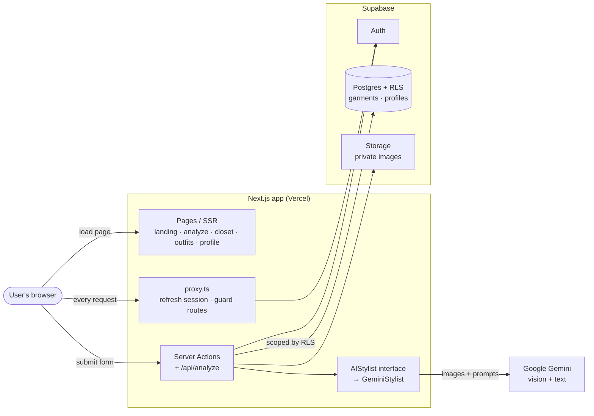

# OutfitMax 👕


**🔗 [Live demo](https://outfitmax.vercel.app)**

Your AI personal stylist. Upload photos of your clothes to get instant styling
feedback, build a searchable digital wardrobe, and generate complete outfits
from pieces you already own — powered by Google Gemini vision.

---

## Features

- **Instant outfit feedback** (no login) — upload one or more clothing photos and
  get an overall rating, what works / what to improve, layering tips, and
  pairing suggestions with shopping links.
- **Digital wardrobe** — upload clothing photos (one or many at once) and Gemini
  automatically tags each item (category, color, material, season, keywords) and
  files it into your private closet.
- **Outfit ideas from your closet** — tell it an occasion and get complete
  outfits assembled *only* from clothes you own, with a "complete it with…"
  suggestion for anything missing.
- **Accounts & privacy** — email/password auth; every user only ever sees their
  own clothes (enforced by database Row-Level Security and private image
  storage). 

## Tech stack 

| Layer | Choice |
| --- | --- |
| Framework | [Next.js 16](https://nextjs.org) (App Router) + TypeScript |
| Styling | Tailwind CSS v4 |
| AI / vision | [Google Gemini](https://ai.google.dev/) (`gemini-3.6-flash`) via `@google/genai` |
| Database / Auth / Storage | [Supabase](https://supabase.com) (Postgres + Auth + Storage) |

The AI layer sits behind a provider-agnostic `AIStylist` interface
(`src/lib/ai/`), so the underlying model can be swapped without touching the
rest of the app.

## Architecture



- The **server holds all secret keys** — the browser never sees the Gemini key or
  the Supabase secret key.
- Styling feedback runs through `/api/analyze`; wardrobe uploads and outfit
  suggestions run through **Server Actions**.
- Clothing images live in a **private** Supabase Storage bucket and are shown via
  short-lived **signed URLs**.

## Design decisions

- **Provider-agnostic AI layer.** All AI access goes through a single `AIStylist`
  interface (`src/lib/ai/`). Swapping Gemini for another model means writing one
  new class — the rest of the app is untouched — and it makes the AI layer easy to
  unit-test by mocking the client.
- **Schema-validated output + retry/backoff.** Every model call requests a strict
  JSON schema and is parsed/validated; transient `429/503` errors retry with
  exponential backoff, while real errors fail fast. This is covered by tests.
- **Row-Level Security over app-level checks.** Each user's wardrobe is isolated
  at the **database** layer (RLS policies scoped to `auth.uid()`), not just in app
  code — and an integration test proves user A can't read user B's data.
- **Private images via signed URLs.** Images never live in a public bucket; the
  server mints short-lived signed URLs only for the owner.
- **Outfit suggestions from a text catalog.** Instead of re-sending every clothing
  image, the wardrobe is summarized as a numbered text list; the model references
  items **by number**, which is cheaper and makes it impossible to hallucinate
  clothes the user doesn't own.
- **Observability built in.** Every AI call logs provider, latency, retry count,
  and validation outcome (pino), so failures and performance are measurable.

## Getting started

### Prerequisites

- **Node.js 20+** (developed on Node 24)
- A free **[Supabase](https://supabase.com)** project
- A free **[Google AI Studio](https://aistudio.google.com/apikey)** API key

### 1. Install

```bash
git clone https://github.com/pranavraju24/outfitmax.git
cd outfitmax
npm install
```

### 2. Configure environment variables

Copy the example file and fill in your own values:

```bash
cp .env.example .env.local
```

| Variable | Where to find it |
| --- | --- |
| `GEMINI_API_KEY` | Google AI Studio → **Create API key** |
| `NEXT_PUBLIC_SUPABASE_URL` | Supabase → Project Settings → Data API |
| `NEXT_PUBLIC_SUPABASE_PUBLISHABLE_KEY` | Supabase → Project Settings → API Keys (publishable) |
| `SUPABASE_SECRET_KEY` | Supabase → Project Settings → API Keys (secret) |

> `.env.local` is git-ignored — your real keys never get committed.

### 3. Set up Supabase

1. **Database:** open the Supabase **SQL Editor** and run the contents of
   [`supabase/schema.sql`](supabase/schema.sql). This creates the `garments` and
   `profiles` tables with Row-Level Security and the required grants.
2. **Storage:** create a **private** bucket named `garments`
   (Storage → New bucket → uncheck "Public bucket").
3. **Auth (for local dev):** Authentication → Sign In / Providers → Email, and
   turn **off** "Confirm email" so signups log in immediately. *(Re-enable this
   before going to production.)*

### 4. Run

```bash
npm run dev
```

Open [http://localhost:3000](http://localhost:3000).

### Run with Docker

The app ships a multi-stage `Dockerfile` (Next.js standalone output) and a
`docker-compose.yml`. With your env values in `.env.local`:

```bash
docker compose --env-file .env.local up --build
```

Supabase itself runs separately (your hosted project, or `npx supabase start`
for a local stack).

## Scripts

| Command | Description |
| --- | --- |
| `npm run dev` | Start the development server |
| `npm run build` | Production build |
| `npm run start` | Serve the production build |
| `npm run lint` | Run ESLint |
| `npm run typecheck` | Type-check with `tsc` |
| `npm test` | Run unit tests (Vitest) |
| `npm run test:integration` | Run RLS integration tests (needs local Supabase) |

## Testing

- **Unit tests** (`npm test`) cover the AI layer: schema-validated output,
  retry/backoff on transient errors, and the swappable-provider factory. The
  Gemini client is mocked, so they're fast and need no network.
- **Integration tests** (`npm run test:integration`) run against a local
  Supabase (`npx supabase start`) and prove Row-Level Security keeps each user's
  wardrobe private.
- **CI** (GitHub Actions) runs lint, typecheck, unit tests, and a production
  build on every push and pull request.

## Project structure

```
src/
├── app/
│   ├── page.tsx            # Landing page
│   ├── analyze/            # Styling feedback (public)
│   ├── closet/             # Wardrobe: upload, grid, actions
│   ├── outfits/            # Outfit suggestions from your closet
│   ├── login/              # Auth screens + server actions
│   ├── profile/            # Account details + log out
│   ├── api/analyze/        # Styling feedback route handler
│   └── _components/         # Shared UI (header, marquee)
├── lib/
│   ├── ai/                 # Provider-agnostic AIStylist (Gemini impl)
│   ├── supabase/           # Browser / server / admin clients
│   ├── auth/               # Data access layer (session gate)
│   └── wardrobe/           # Garment types + image storage helpers
└── proxy.ts                # Route protection (Next.js 16 "proxy")
supabase/schema.sql         # Database schema + RLS policies
```

## Roadmap

- [x] Styling feedback from photos
- [x] Accounts + digital wardrobe with AI auto-tagging
- [x] Multi-photo upload
- [x] Outfit suggestions from owned items
- [x] Scan your closet with a live camera or an uploaded video
- [x] Deploy to production
- [x] Closet search / filter / edit
- [ ] Save favorite outfits
- [ ] Multi-garment parsing (one photo → many items)

## Notes

This is a personal learning project. Secrets are read from environment variables
and never committed; the Supabase **secret key** is used only in server-side
code and never reaches the browser.
